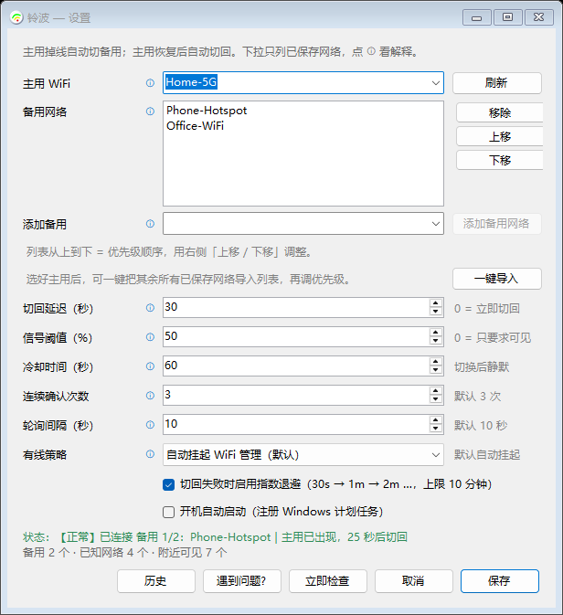
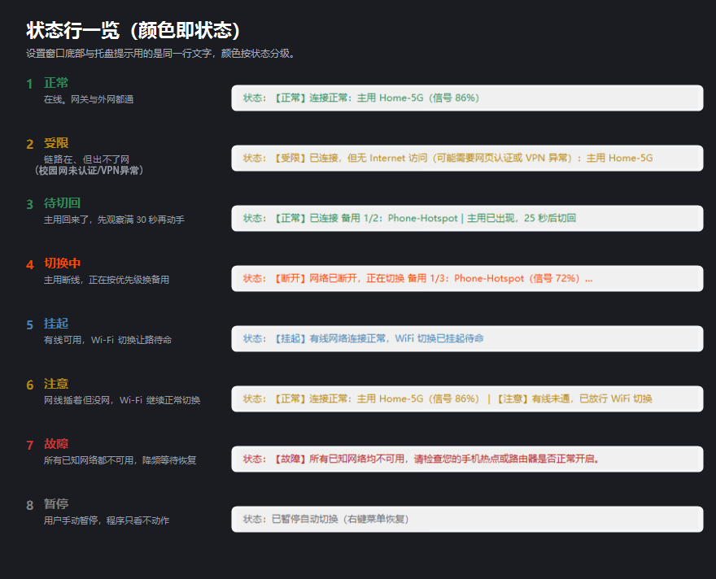
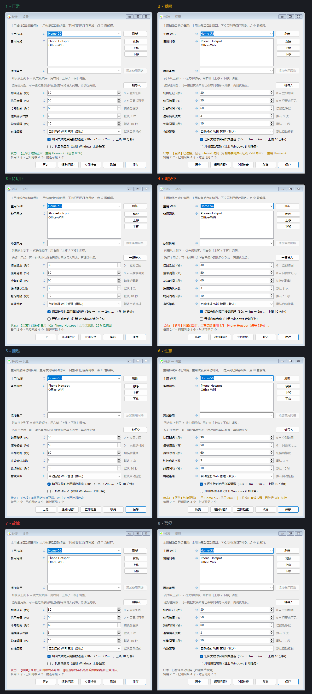
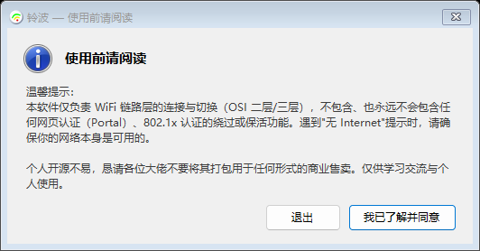

# 铃波（Suzu）

**Windows 托盘 WiFi 自动切换工具**：主用 WiFi 掉线自动切备用，主用恢复并稳定后自动切回；切回/回滚前后都用"走无线网卡"的探测验证连通性。国内外多出口（有线/VPN/校园网）场景也做了分级判定。

[](https://github.com/)
[](https://dotnet.microsoft.com/)
[](LICENSE)

> **温馨提示：**
> 本软件仅负责 WiFi 链路层的连接与切换（OSI 二层/三层），不包含、也永远不会包含任何网页认证（Portal）、802.1x 认证的绕过或保活功能。遇到"无 Internet"提示时，请确保你的网络本身是可用的。
>
> 完整说明见 [DISCLAIMER](#disclaimer) 与 [LICENSE](LICENSE)。

---

## 为什么写这个

Windows 自带的 WiFi 行为是：**主用信号一弱就切到别的网络，可主用恢复了它不一定会自己切回来**。手机热点场景更糟——热点一关，SSID 直接从扫描列表消失，系统只会让你手动重连，断一次连一次。

于是有了铃波（Suzu）：把"该连哪个、什么时候切回去"这件事自动化，同时把"切回去之后到底有没有网"也验证掉。

## 核心功能

- **主用恢复自动切回**：连续多次扫描确认主用真的回来了 + 稳定一段时间（默认 30 秒）才切回，不是一看见就切。
- **热点防误判**：手机热点关闭时 SSID 会彻底消失，程序按"不可用"处理，绝不会误以为"主用恢复"；配合"消失防抖"（连续 3 次 / 30 秒才确认消失）避免扫描抖动引起的误切。
- **冷却 + 指数退避**：切回失败会回滚备用并按 30s → 1min → 2min … 退避（上限 10 分钟），不来回横跳。
- **分级判定（VPN / 校园网兼容）**：区分 Level 0（链路断）/ Level 1（链路通但无外网）/ Level 2（联网正常）。**只有 Level 0 才会切走**——校园网没认证、VPN 节点挂了这类"其实是好的"网络不会被切掉。

## 界面



> 截图中的 SSID 均为示例名（`Home-5G` / `Phone-Hotspot` / `Office-WiFi`），真实网络名已打码。

每个选项左边的蓝色 **ⓘ**：鼠标悬停弹出大白话解释，点一下也会弹窗。

## 吉祥物：铃波（Suzu）


项目吉祥物**铃波**（英文名 **Suzu**）：一位紫发高马尾的少女，刘海上的三色信号发卡（绿→黄→红）正是本工具判断网络状态的三级依据——**绿弧满格联网正常、黄弧受限待认证、红点掉线**。程序图标的大尺寸档就是她的头像，小尺寸档（任务栏/托盘）使用同款信号徽章；程序进入「所有已知网络均不可用」的降级状态时，托盘图标会变成灰色。

## 状态一览

状态行是这套工具唯一需要你"看"的东西，所以颜色本身就是信息——**绿色能上网、琥珀色能连但受限、橙红在切换、蓝色挂起、红色全挂**。



完整窗口（每个状态一张，可直接用于文档或宣传素材，源文件在 `docs/states/`）：



| 标签 | 含义 | 程序行为 |
|---|---|---|
| 【正常】 | 网关通 + 外网通 | 什么都不做，盯着就行 |
| 【受限】 | 链路在，但到不了外网（校园网未认证、VPN 节点异常） | **不切走**，只提示；认证通过后自动回【正常】 |
| 【断开】 | 链路断了，正在按优先级切备用 | 执行切换，切完变【正常】/【受限】 |
| 【挂起】 | 有线可用，WiFi 主动让路 | 不碰 WiFi；拔线或坏线自动恢复 |
| 【注意】 | 网线插着但到不了外网（坏线/对端断电） | **放行** WiFi 切换，不会把你锁死 |
| 【故障】 | 所有已知网络都不可用 | 60 秒低功耗轮询、托盘变灰，网络回来立刻恢复 |

## 参数怎么理解

| 参数 | 含义 | 建议 |
|---|---|---|
| **切回延迟**（默认 30 秒） | 主用恢复后先观察多久再切回。0 = 立即 | 热点/路由器刚重启时信号会抖，**别设 0** |
| **连续确认次数**（默认 3 次） | 连续几次扫描都看到主用才算"真回来了" | 热点不稳可以调到 4~5 |
| **轮询间隔**（默认 10 秒） | 没有系统通知时多久主动检查一次 | **不建议低于 10 秒**：频繁扫描会被部分网卡/驱动限流（`ERROR_BUSY`），反而丢失扫描结果 |
| **信号阈值**（默认 50%） | 主用信号至少要到百分之多少才算可用 | 不同网卡 RSSI→百分比换算不一致；设 0 = 只要求 SSID 可见 |

## 工作方式

```
Normal(在主用)  ──主用消失/网关连续不可达──▶  OnBackup(切备用/备用中)
     ▲                                            │
     └── Returning(切回并验证) ◀── WatchingReturn(主用已出现，倒计时30s) ┘
```

- **切走条件只有 Level 0**：未连接，或连着但网关连续 2 轮不可达（约 20 秒）。
- **切回/回滚都要验证**：连上后先等 DHCP，再用"绑定无线网卡源地址"的 TCP 探测确认真的能出去。
- **有线接入自动让路**：检测到真实以太网网卡 Up 时暂停 WiFi 切换（`🔌`），拔线自动恢复；VPN/Hyper-V 的虚拟网卡不算有线。
- **终极降级**：确实没连上任何 WiFi 且备用连续 3 轮全失败 → `❌ TOTAL_FAILURE`，托盘图标变灰，60 秒低频轮询；任一网络回来立即恢复。

## 架构

```
Suzu.UI   (WinForms 托盘 / 设置 / 免责声明)
     │  依赖
     ▼
Suzu.Core (状态机 / 配置 / 日志 / 数据模型 / 抽象接口)   ← 零 Windows 依赖
     ▲  实现
     │
Suzu.Network (wlanapi P/Invoke / Ping / 路由 / 注册表)
```

- `IWifiProvider`：扫描、连接、配置文件枚举（Windows 实现 = `WindowsWlanProvider`）
- `INetworkVerifier`：网关/外网/有线判定（Windows 实现 = `WindowsNetworkVerifier`）
- `IAutoStart`：开机自启（Windows 实现 = `WindowsAutoStarter`）

**想加 macOS / Linux 支持？** 只要实现 `IWifiProvider` + `INetworkVerifier`，在 `Program.cs`（组合根）里 new 你的实现即可，Core 与 UI 无需改动。欢迎 PR。

## 已知限制

### 隐藏 SSID（关闭广播的网络）不支持

本工具依赖扫描可见性判断「主用是否恢复」。隐藏网络不广播 beacon，扫描列表里看不到（除非本机正连着），因此**主用/备用请不要设为隐藏 SSID**——否则恢复检测会失效，程序会一直停在备用。

### 有线 + 校园网（或其它需认证的有线）并存

如果你的电脑**同时**插着网线（如宿舍的有线端口）并连着校园网 WiFi，请注意：

- 本工具对有线挂起的判定标准是「网关可达 **且** 外网探测通过」。若这根网线本身也需要网页认证（Portal）才能上网，它会因外网探测不通过而被判为**不可用**，WiFi 切换**不会**被挂起；
- 反过来，若网线是通的，而连着的校园网 WiFi 尚未认证，程序会保持 WiFi 连接不切换（状态显示【受限】），但**不会替你完成认证**；
- 网页认证（Portal）、802.1x 的登录/保活涉及具体学校的认证系统，属于本工具**明确不做**的范围（见免责声明）。请先在浏览器里完成认证，程序会在此之后的下一次探测自动把状态恢复为【正常】。

## 关于 VPN 的兼容性说明

- 已在本机对「全局代理模式的 VPN」做过真机验证：主备切换正常、VPN 节点失效时保持连接不乱切。这得益于源绑定探测（绑定 WLAN 网卡 IP，强主机模型保证探测不被隧道劫持）；
- 但 VPN 软件实现差异很大（TUN/TAP 驱动、强制 DNS、接管所有流量的工作模式等），**我们无法保证所有 VPN 软件下表现一致**。如果你的 VPN 会导致判定异常（如状态长期【受限】、频繁误切），欢迎提 Issue 并附上日志，我们会尽量兼容；
- 合规提醒：本工具与任何代理/翻墙功能无关，也不提供此类能力。请在遵守当地法律法规的前提下，通过正规渠道访问互联网。企业/学校的远程办公 VPN（如 EasyConnect、AnyConnect，仅访问内网资源）不影响本工具的判定逻辑。


## 均已做本机验证

| 项目 | 结果 |
|---|---|
| WLAN 接口枚举 / 当前连接 | ✅ 与 `netsh wlan show interfaces` 完全一致 |
| 周边扫描、已保存配置枚举 | ✅ 与 Windows「管理已知网络」一致 |
| 源绑定 TCP 探测 | ✅ 绑定 WLAN 源地址后可通；绑定不存在/回环地址必然不通（反证绑定生效） |
| 网关拦 ICMP 的 AP | ✅ `网关=不通，外网=通` 仍判定 Level 2，不会误切 |
| 分级判定 | ✅ 校园网/VPN 场景判 Level 1 保持不切；链路断判 Level 0 |
| 消失防抖 | ✅ 1/3 → 2/3 → 确认，状态稳定不横跳 |
| 切回 / 回滚 / 退避 | ✅ 日志逐条可查（含失败原因 Detail） |
| 有线接入暂停 | ✅ 插入网线后无任何 `WlanConnect/WlanDisconnect`，拔线自动恢复 |
| TOTAL_FAILURE | ✅ 断开 + 备用连续 3 轮失败进入，托盘变灰，网络回来解除 |
| 单实例 | ✅ 重复双击不新开进程，唤起已运行实例的设置窗口 |
| 开机自启 | ✅ `--autostart` 静默启动不弹窗 |

## 真机验证清单（欢迎补测）
- [ ] 断开主用 → 自动切到优先级最高的可用备用
- [ ] 主用恢复 → 30 秒后切回且验证通过
- [ ] 主用连上但无外网（校园网未认证）→ 保持 🟡，不切走
- [ ] 手机热点关/开 → 不误切，热点稳定后自动切回
- [ ] 插"可用网线"（网关通且外网通）→ 【挂起】待命；拔网线 → 恢复
- [ ] 插"坏网线"（有载波但网关不通，或网关活着但没外网）→ 【注意】放行，WiFi 照常切换
- [ ] 主备全关 → ❌ TOTAL_FAILURE → 重开任一网络自动恢复

## 版本记录

- **v1.2.1**：应用更名**铃波（Suzu，exe 名 `Suzu.exe`）**——原英文名「稳连 WenLian」退役，吉祥物与主程序统一命名。数据目录 `%APPDATA%\WenLian` 自动迁移至 `%APPDATA%\Suzu`，单实例 Mutex/命名管道/开机自启计划任务全部换新名并自动清理旧项，环境变量 `WENLIAN_DATA_DIR` 兼容保留。同时：程序图标更换为吉祥物铃波四档 ico（大尺寸=Q 版头像、任务栏/托盘=信号徽章原图缩放，降级状态灰色变体）；吉祥物设计定稿（刘海三色信号发卡、袖章徽章、蓝条纹）。**【受限】误报修复**：Portal 判定从"单目标一票否决"改为"多目标佐证"（运营商透明 HTTP 劫持插 302 广告页曾让网络正常时误显受限），并新增 HTTPS 443 探测（TLS 证书校验，劫持无法伪造）——任一目标 TLS+204 成功即判定联网正常；设置/免责/历史窗口的标题栏与任务栏图标同步统一。
- **v1.2.0**：体验升级五项（并入了此前三批分支热修：探测任务异常静默、TotalFailure 防抖与再进入迟滞、Portal 劫持识别——未认证校园网正确显示【受限】不切走、无网卡机器日志降频——均已实测）。
  1. **定时暂停**：托盘菜单可暂停 30 分钟 / 1 小时 / 4 小时 / 不定时，到期自动恢复并气泡提醒，暂停期间状态栏显示剩余分钟；
  2. **有线策略可配置**：设置里新增「有线策略」——「自动挂起 WiFi 管理（默认）」或「继续管理 WiFi（忽略有线）」，适合有线限速、WiFi 更快的场景；
  3. **切换历史面板**：设置窗口「历史」按钮 / 托盘菜单「切换历史」，最近 50 次切换/回滚/降级/挂起记录（时间、动作、从→到、原因），支持一键复制，重启清零；
  4. **日志导出（明文/脱敏自选）**：托盘菜单「日志」子菜单——「打开查看（明文，给自己看）」「导出明文副本（自己排查）」「导出脱敏副本（发给别人）」；脱敏副本把已配置的 SSID 自动替换为 NET-1、NET-2… 后存到桌面，发求助贴不怕暴露网络名（本机日志保持明文）；
  5. **隐藏 SSID 边界标注**：设置 ⓘ 与「已知限制」明确说明不支持关闭广播的网络。
  6. **双链路状态文案**：有线策略为「继续管理」且有线在插时，状态栏追加有线侧独立探测结果（`有线：联网正常 / 待认证或无外网 / 链路不通`，90 秒降频探测）——WiFi 与有线的认证状态可能不同（实测随身WiFi 有线口拦认证、无线口放行），"程序显示受限但我明明有网"多因系统流量走的是另一条链路；WiFi 受限但有线可上网时明确提示「系统流量可走有线」。
  7. **判定日志全量落盘**：每次完整探测的 Level 与明细（目标、状态码）都写入日志，"为什么判成受限"可直接从诊断包定位。
- **v1.1.2**：跨设备兼容性专项（125%/150% 缩放的笔记本 + Win10 机房实测）。
  1. **高 DPI 适配**：两个窗口都声明 `AutoScaleMode = Dpi` + 96 DPI 设计基准，125%/150% 下按比例缩放；标签列 110→132px、「移除/上移/下移」按钮宽度改为按文字实测（不再被裁字）；免责弹窗改成纵向流式布局（图标+标题一行、正文 `AutoSize` 自动换行、按钮行右对齐），不再出现图标压住标题、正文被挤掉。
  2. **状态文案修正**：未配置主用时的状态由「尚未配置主用 WiFi，请打开设置」改为「正在等待配置：请在设置中选择主用 WiFi 并保存」；有线异常后缀从长句缩短为 `【注意】有线未通，已放行 WiFi 切换`。
  3. **可观测性增强**（为定位"Win10 机房识别不到任何网络"）：日志现在会打印每个无线接口的 GUID/描述/状态、选中的接口、扫描原始条目数与去重后数量、`WlanGetProfileList` 的 rc 与配置数、单个配置文件解析失败的原因；设置窗口在「已知网络 0 / 附近可见 0」时追加一行排查指引。
  4. **运行环境说明**：见下方「构建」一节。
  5. **设置窗口支持手动拉伸自适应**：窗口从固定对话框改为可拉伸（可最大化），备用列表行弹性吃掉富余高度、输入列随宽度变宽、状态行/提示行按内容自动换行长高；窗口位置与大小会记住（`config.json` 的 `windowLeft/Top/Width/Height`，带屏幕边界钳制，副屏拔掉也不会跑到看不见的地方）。
  6. **新增「遇到问题？」一键导出脱敏诊断包**（托盘菜单同款「导出诊断包」）：把 `log.txt`、脱敏后的 `config.json`（SSID 变成 NET-1/NET-2…）、`系统信息.txt`（版本/系统/运行时/是否管理员/网卡与网关）、`说明.txt` 打成 zip 放到桌面并自动在资源管理器里选中，方便直接把包发给开发者排查。
  7. **诊断包驱动的四项稳定性修复**：第一位内测用户随手导出的诊断包暴露了两个真问题，全部修复——① TCP 探测超时后 Dispose 连接产生的 `SocketException 995` 落在无人观察的 Task 上，被 finalizer 翻出刷屏（实测一天 1170 条 ERROR），现在超时返回前显式观察掉；② TOTAL_FAILURE 0.1 秒进出震荡，深层根因是「网关假死换备用」路径合成了假的「未连接」状态、绕过了「还连着就不进终极降级」的防线——现在传真实连接状态，连着网关不通的网络时改为 60 秒慢轮询、永不进 TOTAL_FAILURE；解除 TOTAL_FAILURE 需已知网络持续可见 ≥15 秒，解除后 3 分钟内不再进入（迟滞防震荡）；虚拟网卡排除表补 `vgate`。
  8. **Portal 劫持识别（校园网未认证不再误显【正常】）**：第二份诊断包实锤——未认证校园网会把所有 TCP 连接劫持到认证服务器，源绑定 TCP 握手"成功"被误判为外网可达，状态错误地显示🟢【正常】。现在外网探测升级为 **HTTP `generate_204` 校验**（业界标准），并按响应严格判定：`/generate_204` 目标**只有 204 算真外网**——实测校园网认证页对任意 GET 返回 `200` + 登录页 HTML（而非 302），200 一律按 Portal 处理；微软 `/connecttest.txt` 需 200 且响应体含固定校验串；DNS 被劫持不影响判定（解析限时 2 秒防拖慢）。**TCP 握手成功但 HTTP 校验未完成（如校园网未认证时直接丢弃 DNS）一律按受限处理**，不再当作有外网；检出 Portal / 校验未完成都判 **Level 1**（🟡【受限】"可能需要网页认证"，保持连接等待认证，绝不切走）。
- **v1.1.1**：有线挂起的判定从「网关通（Level 1）」升级为「网关通 + 源绑定外网探测通过（Level 2）」。实测插着"网关活着但没外网"的有线（如没额度的随身WiFi、需认证的校园网）时，旧版会误挂起 WiFi 导致彻底断网；现在这种情况显示 `【注意】检测到有线连接但无法访问网络，WiFi 将继续执行切换逻辑` 并放行切换。挂起状态下每 10 秒只轻量 ping 有线网关，每 30 秒做一次完整外网复验——有线中途断外网会自动退出挂起、恢复 WiFi 切换。状态文本中的 emoji（🟢🟡🔴❌⚠️🔌）在 WinForms 的 GDI 渲染下显不出彩色，全部改为文字标签（【正常】【受限】【断开】【故障】【注意】【挂起】），设置窗口的状态行同时按标签着色。README 补充有线+校园网并存、VPN 兼容性两节已知限制。
- **v1.0.7**：有线挂起改为「网线插着 + 能 ping 通它自己的网关」双条件。以前只要网卡有载波就挂起 WiFi 切换，遇到坏网线/对端断电会把人锁死在断网状态；现在假死网线只提示放行切换，好网线才显示「有线网络连接正常，WiFi 切换已挂起待命」。
- **v1.0.6**：开机自启从 HKCU Run 注册表项改为**计划任务**（登录触发、最高权限静默运行）——`requireAdministrator` 程序写在 Run 项里会被 Windows 在登录时静默跳过，导致"注册表写对了、重启后程序却没启动"；升级时自动清理旧 Run 项；设置窗口的勾选框文案同步更新。
- **v1.0.5**：开源化改造。应用更名 **WenLian（稳连）**，数据目录迁移至 `%APPDATA%\WenLian`（首次启动自动从旧目录迁移配置，老用户无感升级）；新增**首次启动免责声明**（声明本工具只做链路层切换、不含任何 Portal/802.1x 认证能力）；代码接口化重构为 `WenLian.Network / Core / UI` 三层（Core 零 Windows 依赖，想支持 macOS/Linux 只需实现 `IWifiProvider` + `INetworkVerifier`）；exe 图标与托盘图标统一为同一份多尺寸 ico；新增 MIT LICENSE、NOTICE、.gitignore，README 面向开源重写。
- **v1.0.4**：分级容灾。网络状态分为 Level 0/1/2（链路断 / 网关通无外网 / 完全正常），状态栏五态文案（正常/受限/断开/故障/挂起）并按语义着色；**只有 Level 0 才触发切换**——主用网关连续 2 轮不可达视同掉线（网卡假死兜底），备用网关死了自动换下一个，连着网关正常的第三方网络不折腾；检测到有线时挂起 WiFi 切换（手动检查可穿透）；所有已知网络连续失败进入 TOTAL_FAILURE 终极降级（60 秒低功耗轮询、托盘变灰、网络恢复自动唤醒）；网卡判定排除 VPN/Hyper-V 等虚拟网卡；网关拦 ICMP 的 AP（ping 网关不通但外网可达）正确判为 Level 2；切回前用全新扫描复查主用确实在广播，防止扫描缓存的"幽灵条目"引发无效断线。
- **v1.0.3**：扫描与判定的可靠性加固。扫描读取失败时沿用上次成功结果并跳过判定（绝不用空表冒充"主用消失"）；主用消失增加防抖（连续 3 次或 30 秒没扫到才算真消失，期间切回倒计时不重置；信号低于阈值仍立即判定）；连接发起最多重试 2 次；连通性验证改为**网关优先**——网关通即视为连接成功，网关通但无外网（校园网未认证等）只提示不回滚，杜绝反复横跳。
- **v1.0.2**：外网探测改为**源地址绑定 TCP**（绑定 WLAN 网卡 IPv4 再连接，Windows 强主机模型保证流量只从该网卡出去）。此前插着网线或开 VPN 时系统默认路由从别的网卡出去，ping 通了也不代表 WiFi 能上网，曾导致误判和反复切换；原路由出口校验降级为兜底手段；验证失败的日志附带原因明细（无网关 / 网关通外网断 / 网关不通三档）。
- **v1.0.1**：可靠性修复三件套。「连续 N 次扫描确认」按扫描节奏节流（此前 WLAN 通知一次扫描触发多次唤醒会虚增计数，3 次确认退化成几秒内完成）；连通性验证只认无线网卡的网关（删除任意网卡回退）；冷却/退避/等待全部改用单调时钟（系统校时不再扰乱计时，消除 24.9 天回绕）；配置跨线程读写加锁 + 原子保存（留 .bak）；托盘图标句柄泄漏修复；设置窗口刷新移到后台线程不再卡界面。
- **v1.0.0**：首个可用版本。主用掉线自动按优先级切换备用（切换后 ping 验证），主用恢复稳定 30 秒后自动切回；冷却期、指数退避、验证失败自动回滚；手机热点防误判（SSID 消失 ≠ 主用恢复）；备用多级优先列表、一键导入已保存网络；托盘常驻 + 设置窗口、开机自启、单实例（重复双击唤出设置）。

## 构建

需要 .NET 8 SDK：

```powershell
# 依赖框架版（约 300 KB，需要目标机器装 .NET 8 Desktop Runtime）
dotnet publish .\Suzu.csproj -c Release -o .\dist

# 自包含版（约 65 MB，免安装运行时）
dotnet publish .\Suzu.csproj -c Release -o .\dist-selfcontained -p:SelfContained=true
```

运行需要**管理员权限**：Windows 11 上非管理员进程调用 `WlanQueryInterface / WlanScan` 一律返回 `5 (拒绝访问)`（程序会自动提示并停在只读状态，不会误切网络）。

**运行环境**：依赖框架版需要 **.NET Desktop Runtime 8.0.x x64**——注意**其它版本不能替代**（9.0 / 10.0 都不行，必须是 8.0.x）。不确定机器上装了什么、或是在机房/受控环境（Win10 教育版、没装运行时的公共机），请直接用 **self-contained 免安装版**，双击即可运行、不依赖任何运行时。

## 数据与日志

- 配置：`%APPDATA%\Suzu\config.json`（原子写入，保留 `.bak`；损坏时自动从备份恢复；更名前的 `%APPDATA%\WenLian\` 会在首次启动自动迁移）
- 日志：`%APPDATA%\Suzu\log.txt`（超过 1MB 滚存为 `log.old.txt`）
- 从更名前的版本升级：首次启动会自动把 `%APPDATA%\AutoWiFiSwitch\` 里的配置和日志复制过来（旧目录保留不动）
- 受限环境可用环境变量 `SUZU_DATA_DIR` 指定数据目录（兼容旧 `WENLIAN_DATA_DIR`）

## 贡献

- 提交前请确保 `dotnet build -c Release` **0 警告 0 错误**；
- 涉及判定逻辑的改动请在 PR 里附上日志片段（本项目的每个判定都写了原因，日志本身就是证据）；
- 新增平台支持请只加实现类，不要把平台 API 泄漏到 `Core`。

## DISCLAIMER

首次启动会显示这个弹窗，必须点「我已了解并同意」才会进入托盘（点「退出」直接结束程序；开机自启时推迟到你第一次打开设置再弹）：



**温馨提示：**

> 本软件仅负责 WiFi 链路层的连接与切换（OSI 二层/三层），不包含、也永远不会包含任何网页认证（Portal）、802.1x 认证的绕过或保活功能。遇到"无 Internet"提示时，请确保你的网络本身是可用的。
>
> 个人开源不易，恳请各位大佬不要将其打包用于任何形式的商业售卖。仅供学习交流与个人使用。

- 本软件按"现状"提供，不承诺任何特定场景下的网络可用性；
- 切换网络可能导致**正在进行的下载/通话中断**，请自行评估；
- 因使用本软件造成的任何直接或间接损失，作者不承担责任；
- 请遵守所在网络（校园网/公司网/公共热点）的使用规定，**不要**用它绕过任何认证或计费机制；
- **禁止任何形式的商业售卖**（包括改包装后二次销售、付费分发等），仅供学习交流与个人使用。

## 致谢与说明

- 本项目由 **GLM / DeepSeek / Claude** 多模型协作开发 + 人工复审：方案设计、代码实现、真机日志定位、逐轮 bug 修复均有 AI 参与；所有合入的改动都经过人工确认与真机验证。
- 已验证的关键实现：源地址绑定探测、扫描失败容忍、消失防抖、指数退避、TOTAL_FAILURE 降级——每一条都对应一次真实的线上故障定位。
- 欢迎 Issue / PR；提 Issue 时附上 `log.txt` 相关片段会快很多。

## License

[MIT](LICENSE) © 2026 Suzu contributors
